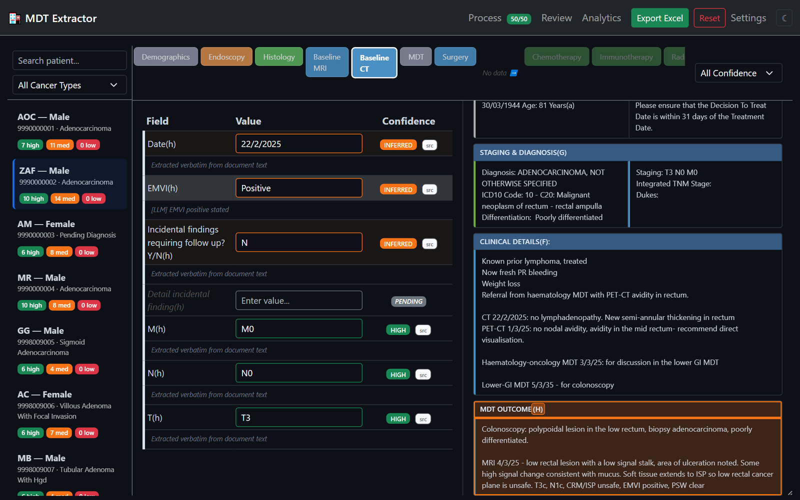
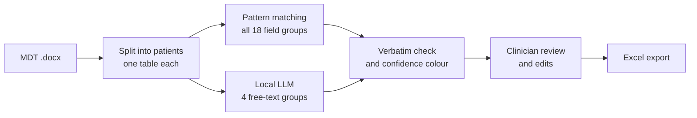

# MDT Data Extractor

Reads the Word documents from cancer multidisciplinary team (MDT) meetings and fills the 88-column patient spreadsheet that clinicians otherwise fill in by hand. The language model runs on your own machine through Ollama, so patient data never has to leave it, and every value it extracts links back to the passage it came from so a clinician can check it.

> **All data in this repository is synthetic.** The 50 MDT cases used to build and test the tool were written by the hackathon organisers, with dummy NHS numbers and shifted dates. No real patient data was used at any point. The spreadsheets in `extraction_results/` are this tool's output on those synthetic cases.



*Reviewing a synthetic patient. Clicking `src` next to EMVI highlights the MDT outcome text the model read it from ("EMVI positive").*

## The problem

Cancer patients in the NHS are discussed at weekly MDT meetings. The case lists and outcomes are circulated as Word documents, and the hospital database they are meant to feed is filled in inconsistently, so researchers end up reading the notes and copying details into their own spreadsheets. The brief, set by an NHS consultant at a clinical AI hackathon in March 2026, asked whether those Word documents could fill a searchable spreadsheet automatically. The full brief is in [`hackathon-brief.md`](hackathon-brief.md).

I built this solo during and after the hackathon.

## How it works



1. **Parse.** Each patient in the document is one Word table. The parser splits the document into patients and removes the duplicate text Word produces for merged cells.
2. **Pattern matching first.** Fields with a fixed format (dates, NHS and hospital numbers, TNM staging, gender) are read by regular expressions across all 18 field groups. No model is involved, so the same document always gives the same values.
3. **The LLM only where it is needed.** The model handles four groups whose answers sit in free-text notes: Endoscopy, Baseline CT, Surgery, and Watch and Wait. For those, the model gets only the sections of the patient's notes that are relevant, which made prompts 50–63% smaller than sending the whole record. Each prompt carries worked examples and a clinical abbreviation list, the Baseline CT prompt adds TNM and EMVI definitions from the Royal College of Pathologists' G049 dataset, and the model must answer in JSON.
4. **Check every answer against the source.** Each value the model returns is searched for in the original text, and every value keeps a pointer to the table cell it came from.
5. **Review, then export.** A clinician reviews each patient side by side with the source document, edits anything wrong, and exports an Excel file.

The first version, written on hackathon day, sent one prompt per field group (16 at the time) with the whole patient record. Moving every fixed-format field to pattern matching made it faster and took the model out of the fields it had no reason to touch.

### Confidence colours

| Badge | Colour | Meaning |
|-------|--------|---------|
| HIGH | Green | Read by pattern matching from a structured cell |
| INFERRED | Orange | Read by the LLM from free text; the value appears word for word in the source |
| LOW | Red | Returned by the LLM but not found word for word in the source, so check it first |
| PENDING | Grey | Nothing found; fill in by hand if the document has it |

An edited field is marked EDITED and keeps its original value in the export.

### The Excel file

The export has three sheets: the patient data in the column layout the organisers asked for, a hidden metadata sheet with each value's source cell, snippet and confidence, and a hidden copy of the raw table text. Because of the last two, the spreadsheet can be imported again on another machine and reviewed with full source highlighting, without the Word document or a model.

## Results

I ran all 50 synthetic patients through five models: four local ones through Ollama and Claude Haiku 4.5 through the API.

| Model | Seconds per patient (mean) | All 50 patients | LLM values found word for word | LLM values not found |
|-------|---------------------------:|----------------:|-------------------------------:|---------------------:|
| Qwen3 8B | 23.9 | 20 min | 228 | 0 |
| Llama 3.1 8B | 43.8 | 37 min | 215 | 2 |
| Qwen3.5 4B | 44.6 | 37 min | 165 | 3 |
| Qwen3 14B | 130.1 | 108 min | 169 | 0 |
| Claude Haiku 4.5 (API) | 7.6 | 6 min | 161 | 2 |

Qwen3 8B was the fastest local model and filled the most fields; the larger Qwen3 14B was more than five times slower and filled fewer. Per-patient figures are in [`extraction_results/benchmarks.xlsx`](extraction_results/benchmarks.xlsx), and each model's full output is next to it. Timings depend on the hardware.

**What these numbers do not show is accuracy.** A value found word for word in the source can still sit in the wrong column. The organisers' target spreadsheet fills in only one example patient, so there is no ground truth for the other 49 yet; hand-labelling a sample and scoring each model against it is the next piece of work.

## Running it

You need Python 3.11+ and [Ollama](https://ollama.com).

```bash
ollama pull qwen3:8b
pip install -r requirements.txt
python app.py              # http://localhost:5000; use --port 5001 if 5000 is taken
```

On Windows, `run.bat` installs the requirements and starts the app.

**To explore without a document or a model:** the hackathon's input document is not in this repository, but you can drag any spreadsheet from `extraction_results/` onto the start page. It opens in the review screen with every patient, colour and source highlight, because the export carries its own source text.

**To extract:** drop an MDT outcome document in the same table format onto the start page and pick a model (the app starts on the lighter `qwen3.5:4b`; choose `qwen3:8b` from the list). On the next page set how many patients to process and press Start Extraction. A Stop button ends the run early.

**Claude instead of Ollama:** put `ANTHROPIC_API_KEY=...` in a `.env` file and choose Claude on the start page. The text is then sent to Anthropic's API, so use this only with synthetic data.

## Tests

```bash
python -m pytest tests/
```

84 tests cover the parser, pattern matching, prompt building, response parsing and the verbatim check, coverage tracking, the Excel round trip and the schema. They do not call a model.

## Project layout

```
app.py                  Flask routes, background extraction, live progress (server-sent events)
parser/                 Word document to patients and table cells
extractor/              pattern matching, prompts, LLM client, response parsing, coverage
config/                 field_schema.yaml (88 fields, 18 groups), per-group prompts, field overrides
export/                 Excel writer, plus a consultation sheet for clinicians to review field definitions
templates/, static/     the review interface (Bootstrap, vanilla JavaScript, Chart.js)
context/                the G049 dataset and the staging notes the prompts draw on
extraction_results/     benchmark timings and each model's output on the synthetic cases
tests/                  pytest suite
```

`WORKFLOW.md` walks through the whole application step by step, and `CLAUDE.md` describes the architecture in more detail.

## Limits

- This is a hackathon prototype, not a medical device, and nothing it produces should be used for patient care without a clinician checking it.
- It expects the hackathon's document layout: one table per patient with the same rows. Other MDT templates would need parser changes.
- Accuracy has not been measured yet (see Results).
